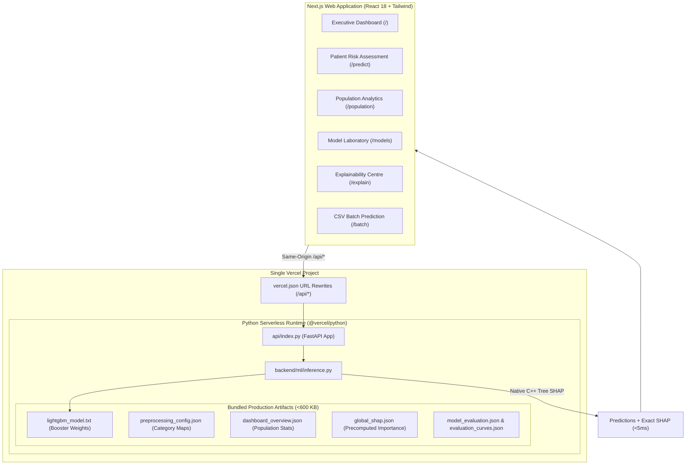

# MedRisk AI
### Explainable Clinical Intelligence for Hospital Readmission Risk Prediction

[](https://vercel.com)
[](https://nextjs.org)
[](https://fastapi.tiangolo.com)
[](https://lightgbm.readthedocs.io)

MedRisk AI is a production-quality, research-grade clinical intelligence application designed to predict the probability of 30-day unplanned hospital readmission for diabetic inpatient encounters and provide real-time, exact Tree SHAP explainability.

> **NON-NEGOTIABLE DEPLOYMENT ARCHITECTURE:**  
> The entire publicly accessible application (Next.js frontend + Python serverless inference API) deploys through a **single Vercel project** with zero external backend servers, zero databases, and zero paid inference APIs.

---

## Architecture & System Overview



---

## Key Clinical & Engineering Capabilities

1. **Patient-Group-Aware Machine Learning**:
   - Trained on 99,343 active inpatient encounters across 70,052 unique diabetic patients.
   - Group-aware splitting strictly by `patient_nbr` ensures **zero patient data leakage** between training and test folds.
   - Deceased patients (in-hospital expiration) standardly excluded to prevent artificial shortcuts.
2. **5-Model Benchmark Laboratory**:
   - Evaluated Logistic Regression, Decision Trees, Random Forests, HistGradientBoosting, and LightGBM.
   - Selected **LightGBM GBDT** achieving **ROC-AUC: 0.6659**, **PR-AUC: 0.2193**, and **Recall: 58.26%** with calibrated decision cutoff (0.55).
3. **Exact Tree SHAP in Serverless Runtime**:
   - Utilizes LightGBM's compiled C++ implementation (`booster.predict(pred_contrib=True)`) to compute exact mathematical Shapley values in microseconds.
   - No heavy JIT dependencies (`numba`, `llvmlite`) required in serverless deployment.
4. **Interactive Patient Assessment**:
   - Quick-load representative clinical encounters or enter custom parameters via the manual clinical form.
   - Semicircular SVG probability gauge with risk tiers: **Low (<15%)**, **Moderate (15–30%)**, and **High (>30%)**.
   - Interactive SHAP waterfall chart explaining feature contributions in plain English.
5. **CSV Batch Prediction**:
   - Drag-and-drop CSV cohort upload with schema validation, risk distribution summary, and enriched CSV export.
6. **Executive Dashboard & Population Analytics**:
   - Real-world epidemiological trends: Length of stay curves, HbA1c control impact, insulin adjustments, and ICD-9 diagnosis clustering.

---

## Artifact Strategy: Local Training vs Production Serverless

| Environment | Purpose | Key Artifacts |
|---|---|---|
| **Local Development** | Model Training, Tuning & Evaluation | `data/diabetic_data.csv`, `backend/ml/train_models.py`, `backend/tests/` |
| **Vercel Serverless** | Real-Time Inference & UI Serving | `api/index.py`, `artifacts/lightgbm_model.txt` (511 KB), `artifacts/*.json` |

Model training is executed locally. The serverless production environment loads only the lightweight compiled booster (511 KB) and precomputed JSON metadata (85 KB), keeping total deployment package size under 1 MB.

---

## Quickstart & Local Setup

### 1. Prerequisites
- Node.js (v18.x or v20.x) & npm
- Python 3.10 or 3.11

### 2. Install Dependencies
```bash
# Install frontend packages
npm install

# Install local Python dependencies
python -m pip install -r requirements.txt
```

### 3. Run Automated Tests
```bash
# Run all 17 unit and API integration tests
python -m unittest discover -s backend/tests -p "test_*.py"
```

### 4. Run Locally
To run both the Next.js frontend and the FastAPI backend locally:
```bash
# Terminal 1: Start Python Serverless API
npm run dev:backend
# API will listen at http://127.0.0.1:8000 (OpenAPI docs at http://127.0.0.1:8000/api/docs)

# Terminal 2: Start Next.js Development Server
npm run dev
# Next.js will run at http://localhost:3000
```

---

## Single-Project Vercel Deployment

Deploying MedRisk AI to Vercel requires **zero external servers, databases, or API keys**.

### Step 1: Push Repository to GitHub
```bash
git init
git add .
git commit -m "feat: complete MedRisk AI clinical platform"
git remote add origin https://github.com/YOUR_USERNAME/medrisk-ai.git
git push -u origin main
```
*(Note: Raw CSV datasets in `data/` are automatically excluded by `.gitignore`)*

### Step 2: Import into Vercel
1. Log in to your [Vercel Dashboard](https://vercel.com/dashboard).
2. Click **"Add New..."** &rarr; **"Project"**.
3. Select your GitHub repository (`medrisk-ai`).
4. Keep the default settings:
   - **Framework Preset**: Next.js
   - **Root Directory**: `./`
   - **Build Command**: `npm run build`
   - **Output Directory**: `.next`
5. Click **"Deploy"**.

### Step 3: Verification
Once deployment completes (typically ~60 seconds):
- Vercel automatically deploys the Next.js frontend.
- Vercel compiles `api/index.py` using `@vercel/python`.
- Requests to `/api/*` are routed directly to the Python serverless function via `vercel.json`.

---

## Reports & Documentation

- [System Architecture](docs/architecture.md)
- [API Documentation](docs/api_documentation.md)
- [Explainability Methodology](docs/explainability_methodology.md)
- [Responsible AI & Clinical Governance](docs/responsible_ai_and_limitations.md)
- [Dataset Profiling Report](reports/dataset_profiling_report.md)
- [Data Dictionary](reports/data_dictionary.md)
- [Data Quality Report](reports/data_quality_report.md)
- [Feature Inclusion / Exclusion Report](reports/feature_inclusion_exclusion_report.md)
- [Model Comparison Report](reports/model_comparison_report.md)

---

## Disclaimer

**RESEARCH AND EDUCATIONAL DECISION-SUPPORT APPLICATION ONLY.**  
MedRisk AI is designed for epidemiological exploration, quality improvement benchmarking, and clinical risk stratification research. It is **not** an FDA-approved medical diagnostic device and should never replace clinical judgment or standard medical care protocols.
