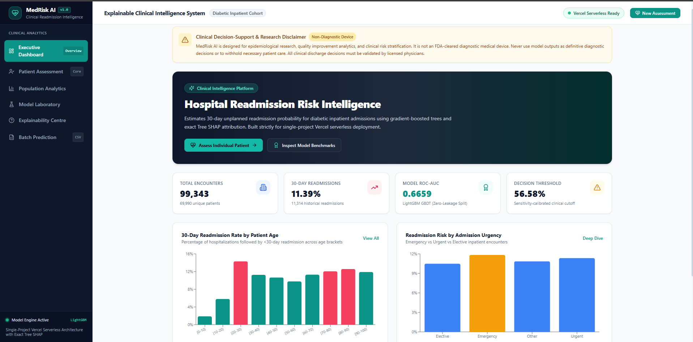
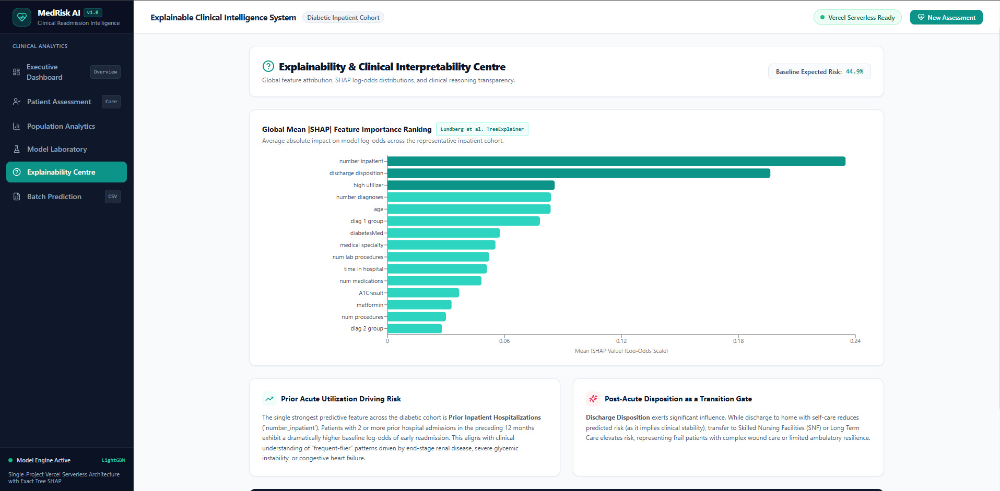
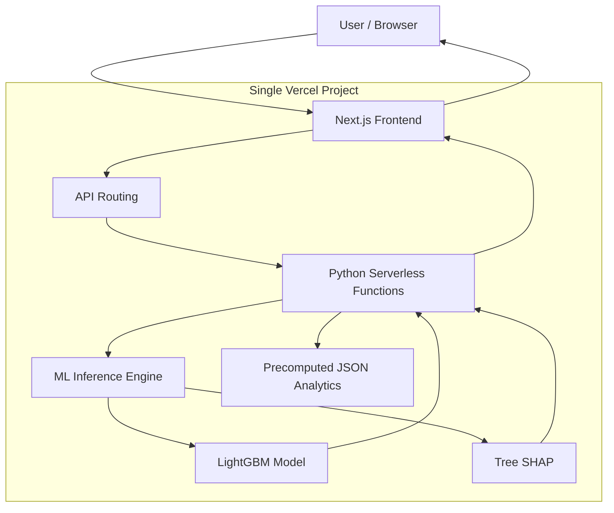

<p align="center">
  
</p>

<p align="center">
  <strong>Turning healthcare data into interpretable risk insights.</strong>
  <br />
  An end-to-end machine learning platform for estimating
  30-day hospital readmission risk among diabetic inpatient encounters.
</p>

<p align="center">
  
  
  
  
  
</p>

<p align="center">
  <a href="https://med-risk-ai-nine.vercel.app/">
    
  </a>
  <a href="https://github.com/RagulRishwanth/MedRisk-AI">
    
  </a>
</p>

---

<p align="center">
  ⚡ <strong>Predictive Analytics</strong>
  &nbsp; • &nbsp;
  🧠 <strong>Explainable AI</strong>
  &nbsp; • &nbsp;
  📊 <strong>Healthcare Insights</strong>
  &nbsp; • &nbsp;
  ☁️ <strong>Serverless Deployment</strong>
</p>

---

## Overview

MedRisk AI is an interactive healthcare analytics and machine learning platform designed to estimate the probability of 30-day hospital readmission among diabetic inpatient encounters.

Hospital readmissions are an important indicator of healthcare quality, continuity of care, and patient outcomes. Identifying encounters associated with a higher likelihood of readmission can help researchers investigate patient characteristics, treatment patterns, and potential risk factors.

MedRisk AI addresses this problem through an end-to-end machine learning pipeline built around historical diabetic inpatient encounter data.

The platform integrates **LightGBM-based prediction, patient-group-aware model evaluation, Tree SHAP explainability, and interactive healthcare analytics** into a unified web application.

Unlike a standalone machine learning notebook, MedRisk AI brings together model development, evaluation, inference, interpretability, and deployment into an accessible application.

## Key Highlights

- 30-day hospital readmission risk estimation at the individual encounter level.
- Patient-group-aware train/test evaluation to reduce patient-level data leakage.
- LightGBM model selected through comparative evaluation of multiple machine learning algorithms.
- Local prediction explanations using Tree SHAP.
- Interactive population-level healthcare analytics.
- Model comparison and evaluation laboratory.
- CSV-based batch prediction with downloadable results.
- Serverless deployment combining Next.js and Python inference functions.
- Compact model artifacts for efficient deployment.

---

<p align="center">
  
</p>
<p align="center">
  <em>MedRisk AI — Executive Dashboard and Population Insights</em>
</p>

## Application Features

### 1. Patient Risk Assessment

Generate individual 30-day readmission risk estimates through an interactive patient assessment interface.

**Capabilities:**
- Assess individual inpatient encounters.
- Explore representative historical patient encounters.
- Enter custom clinical parameters.
- Generate estimated readmission probabilities.
- Visualize estimated risk through an interactive risk gauge.
- Inspect feature-level contributions influencing individual predictions.

The application uses presentation categories to communicate estimated risk:

| Risk Category | Estimated Probability |
|---|---|
| Low | Below 15% |
| Moderate | 15–30% |
| High | Above 30% |

These categories are application-defined presentation thresholds and are not clinically validated decision boundaries.

### 2. Explainable AI — Tree SHAP

Model interpretability is a core component of MedRisk AI.

The platform uses LightGBM's native Tree SHAP implementation to explain individual predictions and explore the contribution of input features.

**Explainability capabilities:**
- Individual prediction explanations.
- Positive and negative feature contributions.
- Global feature importance.
- Interactive SHAP waterfall visualizations.
- Plain-language interpretation of influential features.

<p align="center">
  
</p>
<p align="center">
  <em>Individual prediction explanation using Tree SHAP</em>
</p>

Tree SHAP helps make the model's behavior more transparent by showing how individual input features contribute to a prediction.

The deployed implementation uses LightGBM's compiled C++ prediction functionality rather than requiring heavyweight JIT dependencies.

### 3. Population Analytics

Explore patterns across historical diabetic inpatient encounters through interactive visualizations.

**Analytics include:**
- Readmission trends across patient age groups.
- Gender-based comparisons.
- Admission and discharge patterns.
- Length-of-stay analysis.
- HbA1c control patterns.
- Insulin adjustment patterns.
- Diagnosis-related trends.
- Population-level readmission distributions.

These visualizations provide an exploratory view of the underlying dataset and its associated readmission patterns.

### 4. Model Laboratory

MedRisk AI includes a model evaluation environment for comparing multiple machine learning algorithms using a consistent evaluation methodology.

**Models evaluated:**

- Logistic Regression
- Decision Tree
- Random Forest
- HistGradientBoosting
- LightGBM

**Evaluation metrics:**

| Metric | Purpose |
|---|---|
| Accuracy | Overall proportion of correct predictions |
| Precision | Reliability of positive predictions |
| Recall | Proportion of actual readmissions identified |
| F1-score | Balance between precision and recall |
| ROC-AUC | Ability to distinguish between classes |
| PR-AUC | Performance under class imbalance |
| Confusion Matrix | Breakdown of classification outcomes |

The evaluation emphasizes recall, precision-recall trade-offs, and model behavior rather than relying exclusively on accuracy.

### 5. CSV Batch Prediction

The platform supports batch inference through CSV uploads.

Users can upload a CSV containing compatible encounter features to:

- Validate the uploaded input schema.
- Preview uploaded records.
- Generate readmission-risk estimates.
- Explore predicted risk distributions.
- Download enriched prediction results.

Uploaded files are processed without requiring persistent patient-data storage.

---

## Machine Learning Methodology

### Dataset

MedRisk AI uses the diabetic hospital encounter dataset and its accompanying patient and encounter ID mapping information.

| Dataset Characteristic | Value |
|---|---|
| Total inpatient encounters | 99,343 |
| Prediction target | 30-day readmission |
| Problem type | Binary classification |
| Positive class | Readmitted within 30 days |
| Negative class | Not readmitted within 30 days |

The dataset contains multiple encounters for some patients, making patient-level separation important during model evaluation.

### Target Engineering

The original `readmitted` variable is transformed into a binary classification target.

| Original Label | Derived Target |
|---|---|
| `<30` | Readmitted |
| `>30` | Not readmitted within 30 days |
| `NO` | Not readmitted within 30 days |

The objective is to identify encounters followed by a readmission within 30 days.

Patient identifiers and encounter identifiers are excluded from model predictors.

In-hospital expired encounters are excluded from the modelling cohort.

### Leakage-Aware Evaluation

A key challenge in healthcare encounter datasets is the presence of repeated hospital encounters belonging to the same patient.

A conventional random train/test split can introduce information leakage when encounters from the same patient appear in both training and testing partitions.

To address this, MedRisk AI uses **patient-group-aware data splitting based on `patient_nbr`**.

This ensures that encounters belonging to the same patient are kept within the same partition.

The evaluation workflow is designed to provide a more realistic assessment of model generalization to previously unseen patients.

### Model Selection

Five machine learning algorithms were evaluated before selecting LightGBM as the final prediction model.

LightGBM was selected based on its performance within the project's evaluation methodology.

**Reported LightGBM evaluation results:**

| Metric | Result |
|---|---:|
| ROC-AUC | 0.6659 |
| PR-AUC | 0.2193 |
| Recall | 58.26% |

These results should be interpreted in the context of the dataset's class distribution, evaluation methodology, and limitations.

The project prioritizes transparent evaluation and the precision-recall trade-off rather than presenting accuracy as the sole measure of model performance.

---

## System Architecture

MedRisk AI follows a single-project serverless architecture.

The Next.js frontend and Python inference API are deployed together through Vercel, without requiring a separately hosted backend or external database.

### Architecture Diagram



### Deployment Components

| Component | Technology | Responsibility |
|---|---|---|
| Frontend | Next.js, React, Tailwind CSS | User interface and visualizations |
| API | Python serverless functions | Prediction and explanation endpoints |
| ML Engine | LightGBM | Readmission-risk estimation |
| Explainability | Tree SHAP | Feature-level prediction explanations |
| Analytics | Precomputed JSON | Dashboard and population statistics |
| Hosting | Vercel | Frontend and API deployment |

### Local Training, Serverless Inference

Model training and production inference are deliberately separated.

| Environment | Responsibilities |
|---|---|
| Local Development | Dataset processing, model training, tuning, and evaluation |
| Vercel Deployment | Model inference, explanations, and application delivery |

The deployed application uses exported model and metadata artifacts rather than loading the original training dataset for every prediction request.

Reported production artifacts include:

- `lightgbm_model.txt` — approximately 511 KB.
- Preprocessing configuration and category mappings.
- Dashboard population statistics.
- Global SHAP information.
- Model evaluation metadata and curves.

The reported combined model and metadata payload is under 1 MB.

This design keeps the deployed inference environment compact and avoids unnecessary loading of the original training data.

---

## Technology Stack

| Category | Technologies |
|---|---|
| Programming Languages | Python, TypeScript, JavaScript |
| Data Processing | Pandas, NumPy |
| Machine Learning | Scikit-learn, LightGBM |
| Explainable AI | Tree SHAP |
| Backend | Python Serverless Functions |
| Frontend | Next.js 14, React 18 |
| Styling | Tailwind CSS |
| Visualization | Recharts, SVG |
| Deployment | Vercel |
| Version Control | Git, GitHub |

---

## Local Development

### Prerequisites

Ensure the following are installed:

- Node.js 18 or newer
- Python 3.10 or 3.11
- npm
- Git

### 1. Clone the Repository

```bash
git clone https://github.com/RagulRishwanth/MedRisk-AI.git

cd MedRisk-AI
```

### 2. Install Frontend Dependencies

```bash
npm install
```

### 3. Install Python Dependencies

```bash
python -m pip install -r requirements.txt
```

### 4. Run Automated Tests

```bash
python -m unittest discover -s backend/tests -p "test_*.py"
```

### 5. Start the Application

Start the backend in one terminal:

```bash
npm run dev:backend
```

Start the frontend in another terminal:

```bash
npm run dev
```

### 6. Access the Application

| Service | URL |
|---|---|
| Web Application | http://localhost:3000 |
| API Documentation | http://127.0.0.1:8000/api/docs |

**Note:** The original training datasets are intentionally excluded from the public repository. Follow the project documentation for local dataset setup and model training.

---

## Vercel Deployment

MedRisk AI is designed to run as a single Vercel project.

The deployment architecture includes:

- Next.js frontend.
- Python serverless inference functions.
- Same-origin `/api/*` requests.
- Bundled model and preprocessing artifacts.
- Precomputed population analytics.

No separate backend hosting service, external database, or paid inference API is required for the deployed architecture.

### Deploy Your Own Instance

1. Push the project to GitHub.
2. Import the repository into [Vercel](https://vercel.com/).
3. Configure the project using the repository's deployment configuration.
4. Deploy the application.
5. Verify the frontend and API endpoints.

Raw training datasets are excluded from Git. The deployed application uses exported model artifacts and precomputed analytics.

---

## Project Documentation

Additional technical documentation and reports are available in the repository.

### Architecture and Methodology

- System Architecture
- API Documentation
- Explainability Methodology
- Responsible AI and Limitations

### Dataset and Modelling Reports

- Dataset Profiling Report
- Data Dictionary
- Data Quality Report
- Feature Inclusion and Exclusion Report
- Model Comparison Report

Refer to the `docs/` and `reports/` directories for detailed technical documentation.

---

## Responsible AI and Limitations

MedRisk AI is a research and educational application developed to explore machine learning approaches for hospital readmission-risk estimation.

It is not a clinically validated diagnostic or decision-making system.

Important considerations:

- Predictions are statistical estimates, not clinical diagnoses.
- The model is trained on a specific historical diabetic inpatient dataset.
- Performance may differ across hospitals, populations, and healthcare settings.
- Model explanations indicate feature contributions, not causation.
- Application-defined risk thresholds are not clinically validated decision boundaries.
- The model has not undergone prospective clinical validation or medical-device approval.

**MedRisk AI must not be used as a substitute for clinical judgment, medical advice, or standard patient-care protocols.**

---

## Future Improvements

Potential directions for further development include:

- Evaluation on independent and geographically diverse healthcare datasets.
- Further model calibration and threshold analysis.
- Improved generalization across patient populations.
- Expanded model monitoring and performance analysis.
- Additional interpretability and fairness assessments.
- Integration of more comprehensive clinical risk factors.

---

## Author

**Ragul Rishwanth P**

AI Engineering | Machine Learning | Generative AI | Explainable AI

- GitHub: [RagulRishwanth](https://github.com/RagulRishwanth)
- LinkedIn: [Ragul Rishwanth](https://www.linkedin.com/in/ragul-rishwanth-5330ba210/)
- Portfolio: [ragul-rishwanth-portfolio.vercel.app](https://ragul-rishwanth-portfolio.vercel.app/)

---

<p align="center">
  <strong>MedRisk AI</strong>
  <br>
  Making healthcare machine learning more transparent, interpretable, and accessible.
</p>
